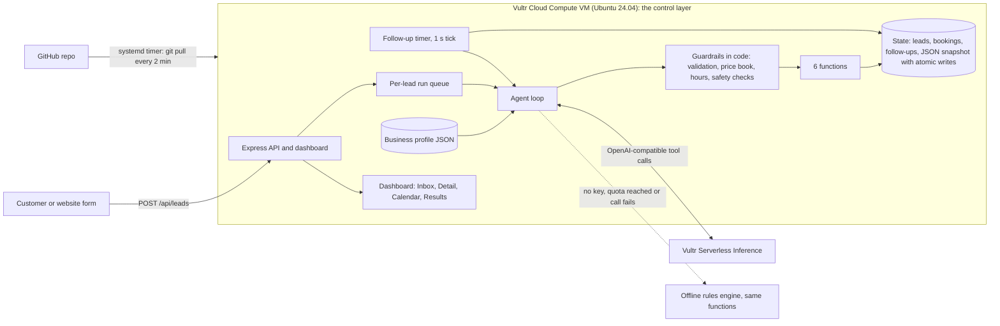

# First Answer Agent

**An AI front desk for any small business: the sales-ops and customer-support work an office coordinator does. It answers new leads, works out what they need, checks open appointment times, books, follows up if they go quiet, and hands off to a person when it is unsure.**

Built for **Vultr Agent Rush (lablab.ai), Challenge 2: Powering the Future of Work** (sales operations and customer support). Everything specific to one kind of business lives in one **business profile** file, so the same agent runs a dental office, a hair salon or a tax and bookkeeping office. Three profiles ship; a dental office is the default demo.

> Disclosure: this repository was built during Vultr Agent Rush (Nov 3-8, 2026). It is new, original work started for this event.

## Real vs simulated

| Part | Status |
| --- | --- |
| Vultr Cloud Compute VM (`vc2-1c-2gb`, Atlanta) running the app | **Real** |
| Vultr Serverless Inference model calls with tool calling (model `glm-5.3-flash`, verified live with tool calling) | **Real** |
| Guardrails in code (validation, price book, hours, double-booking, handoff rules, injection screening) | **Real**, run on every message |
| Calendar and booking logic (hours, notice time, no double booking) | **Real logic**, on the app's own calendar store |
| Persisted state (leads, bookings, follow-up timers, JSON file with atomic writes) | **Real** |
| Follow-up timers | **Real** timers (on a 60x demo clock by default) |
| SMS and email sending | **Simulated.** Nothing leaves the app. |
| Customers and sample leads | **Simulated** (fictional names, 555 numbers) |
| The calendar being a business's actual calendar | **Simulated.** It is the app's own store; there is no Google or Outlook sync yet. |

If no inference key is set, or the model is unreachable or over its quota, the same app runs in an **offline rules mode** that follows the same path through the same guarded functions. The header badge and `/api/health` say which mode is active; the badge never shows a model name unless a model is answering.

## Why it matters

For a small service business, the first one to answer usually gets the booking. Owners and front-desk staff are with a customer, on the phone or closed for the night. First Answer Agent gives every new lead a useful, honest first reply, asks the one question it needs, offers real open times, and sends anything risky straight to a person. Reply times are measured by the server, shown on the Results screen, and labeled by whether a model or the offline rules produced the reply.

## What you can see in the app

| Screen | What it shows |
| --- | --- |
| **Live Inbox** | Every lead with service, source, **measured** reply time and status chip (New, Replied, Booked, Needs a Human). The header badge shows the true agent mode. "Simulate a new lead" runs one of the profile's fictional scenarios end to end. |
| **Lead Detail** | The conversation, a box to role-play the customer, and **"What the agent did"**: a step-by-step timeline of every function call with arguments, result and elapsed time. |
| **Calendar** | A week view of bookings and open appointment times from the app's own calendar store. |
| **Results** | **Measured median reply time (live runs)** with the run count and a model/rules split, leads answered, appointments booked, handed to a human. Simulated sample-day data is excluded by default and clearly labeled when shown. |
| **Guardrails** | The rules the software enforces for the active profile: hours, price book, always-human topics, urgent handling. |
| **/lead** | A public customer form. The customer watches the agent reply on the page. |

Screenshots will be added here after the live deployment.

## Make it yours

Everything that depends on the kind of business is in `config/profiles/<name>.json`: business name, agent signature name, phone, time zone, accent color, hours and appointment length, optional service area, the list of services with price ranges (or "quote required"), urgent-situation phrases, topics that always go to a person, out-of-scope services, form wording, and the example scenarios and sample leads.

1. Copy a profile: `cp config/profiles/dental.json config/profiles/myshop.json`
2. Edit it (the file is validated at startup with a clear error message if something is wrong).
3. Run with `BUSINESS_PROFILE=myshop npm start` (or set `BUSINESS_PROFILE=myshop` in the env file on the VM; `deploy/cloud-init.sh` has a variable for it).

The agent prompt, the rules engine, `qualify_lead`, the safety checks, the calendar, the UI wording and the demo data all read from the profile. Nothing in the code assumes one trade. Shipped profiles:

| Profile | Business | Appointment | Urgent handling example |
| --- | --- | --- | --- |
| `dental` (default) | Brightwater Family Dental | 1 hour | knocked-out tooth, severe pain, facial swelling |
| `salon` | Willow & Oak Hair Studio | 2 hours | burning scalp or swelling after a color service |
| `accounting` | Cedar Ridge Tax & Bookkeeping | 1 hour | IRS levy or audit notice, deadline due now |

All business names, people and phone numbers are fictional.

## Architecture



### Vultr services used

* **Vultr Cloud Compute VM** (`vc2-1c-2gb`, Atlanta, Ubuntu 24.04) is the control layer. It runs the Express API, the dashboard, the calendar and booking store, the follow-up timers, the guardrails and the agent loop. It is provisioned by one startup script ([`deploy/cloud-init.sh`](deploy/cloud-init.sh)).
* **Vultr Serverless Inference** (OpenAI-compatible, `https://api.vultrinference.com/v1`) is the agent's reasoning engine. The agent sends chat-completion requests with function definitions and executes the function calls the model returns. Default model: `glm-5.3-flash`, which was verified live with tool calling (override with `VULTR_INFERENCE_MODEL`).

Serverless Inference is optional for this challenge, but it is the primary path. The VM works on its own: with no key the same app runs in offline rules mode.

## The agent: how it executes real tasks

Every lead run is a tool-calling loop. The model never touches state directly; it can only call six functions, and every call is validated and guarded in code.

| Function | What it really does |
| --- | --- |
| `qualify_lead` | Records which of the profile's services the customer wants, and urgency (and location, if the profile has a service area). **Code** decides service-area status and returns the only price range the agent may quote from the profile's price book. |
| `check_calendar` | Returns open appointment times from the calendar store (business hours only, 2 hours notice, no taken slots). |
| `book_appointment` | Writes a booking. Refuses double booking (synchronous check-and-write), times outside business hours or in the past, out-of-scope or out-of-area leads, and leads already flagged for a human. |
| `send_reply` | Writes the outgoing message into the thread. **Simulated send**: no SMS or email leaves the app. Passes the outbound guard first. |
| `schedule_followup` | A real timer in the app. If the customer has not replied when it is due, the follow-up is posted; if they replied, booked or were handed to a human, it is cancelled. |
| `escalate_to_human` | Flags the lead **Needs a Human** with a reason and priority, and cancels timers. |

Reliability and cost control: per-lead serialized runs, a cap on concurrent runs, a step cap per lead (default 8), a per-call timeout (default 20 s), one retry with backoff on 429 and 5xx, a global hourly cap on model runs plus a per-visitor hourly cap (reserved when a run starts), and strict argument validation (types, enums, lengths, unknown keys dropped, control characters stripped). If the model answers in prose or makes no tool calls, the offline rules finish the lead through the same guarded functions instead of escalating a normal request.

### Offline rules mode

If `VULTR_INFERENCE_KEY` is not set, the hourly or per-visitor quota is reached, or an inference call fails, a deterministic rules engine follows the **same path** and calls the **same guarded functions**. The run is labeled "Offline rules mode" in the timeline, the header badge and `/api/health` (for example "Offline rules mode (hourly model quota reached)"). Reply time is measured from lead arrival to the first reply, so offline replies are near-instant and model replies include inference latency.

### Guardrails (enforced in code, not only in the prompt)

These checks run in software on every message and every outgoing reply. What each one blocks:

* **Business hours:** no booking outside the profile's hours. Times only come from the calendar store.
* **Price book:** any dollar amount in a reply must fall inside the range from `qualify_lead`. Otherwise the message is blocked; the agent must quote the range, say the cost is confirmed in person, or hand off. Discounts, refunds, guarantees, warranties, free work and links in outgoing messages are blocked.
* **Always hand off to a person:** urgent situations defined by the profile (priority "urgent" with a safety note), complaints and angry customers, topics the profile lists (for example insurance and billing at the dental office, tax or legal advice at the accounting office), schedule changes, requests for a person, out-of-scope services, out-of-area requests, unclear leads after two questions.
* **Prompt injection:** customer text is always data. It is fenced in the prompt and scanned by a deterministic classifier before any model call; messages that try to give the agent instructions are flagged for a human. The classifier is keyword-based and conservative, so it can hand off an ordinary message that sounds like an instruction. The booking, price-book and handoff checks run in code after the model, so a model that is talked into a bad action is still stopped at those checks. See `test/safety.test.js`, `test/profiles.test.js`, `test/agent-offline.test.js` and `test/model-loop.test.js`.
* **Public endpoints:** body size limit (8 KB), field limits, per-minute and per-hour per-IP rate limits, strict CSP headers, all customer text HTML-escaped on render. Lead lists and details mask phone numbers; writing to a lead (customer replies, thread messages) needs that lead's secret token. Visitor bookings expire after 2 hours and are capped, sample-day leads are never evicted, and `POST /api/demo/reset` reloads the sample day (rate limited, never touches the model budget).

## Run it locally

Requires Node 22. No build step.

```bash
npm install
npm start            # http://localhost:3000, default profile, offline rules mode, sample day pre-loaded
BUSINESS_PROFILE=salon npm start
```

To use Vultr Serverless Inference:

```bash
export VULTR_INFERENCE_KEY=...            # never commit this
export VULTR_INFERENCE_MODEL=glm-5.3-flash   # optional, this is the default
npm start
```

Useful environment variables are listed in [`.env.example`](.env.example). `npm run seed` resets the data file and reloads the sample day. Follow-up delays run on a demo clock (`FOLLOWUP_SPEEDUP`, default 60, so 30 minutes fires in 30 seconds); set it to `1` for real time. Set `TRUST_PROXY=1` only when the app sits behind one reverse proxy (Caddy, nginx); it is off by default so rate limits key on the real socket address.

Public intake: open `/lead`, or `POST /api/leads` with JSON `{ "name", "phone", "message", "source" }`.

## Deploy on Vultr

1. Create a Startup Script from [`deploy/cloud-init.sh`](deploy/cloud-init.sh) (Products > Startup Scripts). Set `VULTR_INFERENCE_KEY` (and optionally `BUSINESS_PROFILE`, `REPO_URL`, `VULTR_INFERENCE_MODEL`) at the top of the script. Secrets are written to `/etc/first-answer-agent.env` (root-only, mode 600) at install time and are never in the repo.
2. Deploy a Cloud Compute VM, Ubuntu 24.04, with that startup script.
3. The script installs Node 22, clones the repo as the app user, creates a `systemd` service on **port 80**, opens only ports 22 and 80 in `ufw`, and installs a `systemd` timer that runs `git pull` and restarts the service **every 2 minutes**; a failed install or health check rolls back and shows up in `journalctl -u first-answer-agent-update`. To redeploy, push to the repo.
4. Check `http://<vm-ip>/api/health` (mode, model, quota, version, uptime).

**SSH:** port 22 is left open for the VM's normal SSH access. Key-only SSH is recommended: attach an SSH key when you create the VM and set `PasswordAuthentication no`.

## Tests

```bash
npm test      # node --test, 157 tests
```

The same flows (price question and booking, urgent situation, angry customer, prompt injection, after-hours, vague message, always-human topics, sample day, model prompt and tool definitions) run against all three profiles, plus function validation, price-book and outbound guards, booking conflicts and races, the safety classifier, the offline engine, follow-up timers, the tool-calling loop against mocked and real local OpenAI-compatible servers, API validation, rate limiting, demo protection, persistence, and the deploy and update scripts.

## Honest limitations

* **Messages are simulated.** No real SMS or email is sent, and there is no real phone number behind the form. Demo data is fictional.
* **The calendar is the app's own.** There is no Google Calendar or Outlook sync yet.
* **Auth:** the demo dashboard is open (phone numbers are masked, writes need a per-lead token). A real deployment needs sign-in and per-business tenancy.
* Storage is a single JSON file, which is fine for a demo and one VM, not for scale.
* The rules classifier is deliberately conservative: it may hand off an ordinary message that sounds like an instruction. That is the safe direction.
* Prices, hours and wording are example configuration in the profiles. The agent gives no medical, legal or tax advice and says costs are confirmed in person.

## Real next steps

* GoHighLevel integration: create contacts and opportunities, send real SMS through its conversations API, sync appointments.
* Twilio or carrier SMS for true two-way texting, with consent and quiet hours.
* Google Calendar and Outlook two-way sync, with staff and travel-time rules.
* A profile editor screen; multi-tenant accounts and sign-in.
* Missed-call text-back, intake photos and documents, review requests after the visit.

## License

MIT. See [`LICENSE`](LICENSE).
