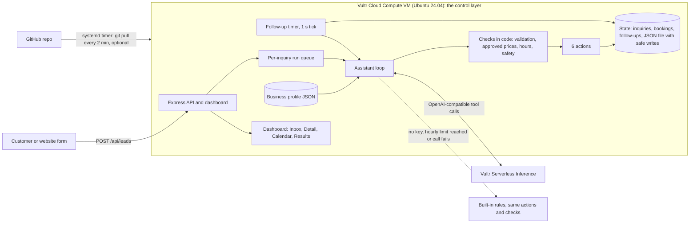

# First Answer Agent

**A virtual front desk for a small business. It answers every new inquiry, finds out what the customer needs, offers open times from its calendar, books the visit, follows up if the customer goes quiet, and hands anything sensitive to a person.**

Built for **Vultr Agent Rush (lablab.ai), Challenge 2: Powering the Future of Work** (sales operations and customer support). Everything specific to one kind of business lives in one **business profile** file. Three example businesses ship (a dental office, a hair salon and a tax and bookkeeping office), and you add your own with one file. A dental office is the default demo, and a **Switch business** control in the dashboard header shows the other two in one click.

> Disclosure: this repository was built during Vultr Agent Rush (Nov 3-8, 2026). It is new, original work started for this event. The initial layers were committed together; later changes are individual commits.

## Real vs simulated

| Part | Status |
| --- | --- |
| Vultr Cloud Compute VM (`vc2-1c-2gb`, Atlanta) running the app | Built and tested; live deployment in progress |
| Vultr Serverless Inference model calls with tool calling (default model `glm-5.3-flash`) | Built and tested against mocked and local OpenAI-compatible servers; proof from the deployed VM will be added here |
| Safety checks in code (input validation, approved prices, business hours, double booking, handoff rules, instruction-in-message screening) | **Real**, run on every message |
| Booking rules (business hours, 2 hours notice, no double booking) | **Real rules** on the app's built-in calendar |
| Saved state (inquiries, bookings, follow-up timers, one JSON file with safe writes) | **Real** |
| Follow-up timers | **Real** timers (shortened for the demo: 30 minutes becomes 30 seconds) |
| Texts and emails | **Simulated.** Nothing leaves the app. |
| Customers and sample inquiries | **Simulated** (fictional names, 555 numbers) |
| The calendar being a business's actual calendar | **Simulated.** It is the app's own calendar; there is no Google or Outlook sync yet. |

If no AI key is set, or the AI model cannot be reached or is over its hourly limit, the app switches to **backup mode**: built-in rules that follow the same steps and use the same safety checks. The header badge and `/api/health` say which mode is active. The badge shows a model name only while the AI model is really answering, and `/api/health` reports `modelVerified: true` only after a real test call to the model succeeded.

## Why it matters

For a small business, the first one to answer usually gets the booking. Owners and front-desk staff are with a customer, on the phone or closed for the night. First Answer Agent gives every new inquiry a useful, honest first reply, asks the one question it needs, offers open times from its calendar, and sends anything risky straight to a person. The dashboard shows how long each reply actually took and whether the AI model or the built-in rules wrote it.

## What you can see in the app

New inquiries (leads) come in from the contact form, a text or a call; the dashboard calls them inquiries.

| Screen | What it shows |
| --- | --- |
| **Switch business** (header) | Reloads the whole app as the dental office, the hair salon or the tax office: name, colors, services, hours, example inquiries and sample data all change. |
| **Live Inbox** | Every inquiry with service, source, reply time and status (New, Replied, Booked, Needs a person). "Simulate a new inquiry" runs one of the business's fictional scenarios from start to finish; "Reset demo" reloads the sample data. |
| **Inquiry detail** | The conversation, a box to type as the customer, and **"What the assistant did"**: a step-by-step list of every action with its details and timing. |
| **Calendar** | A week view of bookings and open appointment times from the app's own calendar. |
| **Results** | Typical reply time (median) of live replies, how many came from the AI model and how many from built-in rules, inquiries answered, appointments booked, and inquiries that need a person. The fictional sample day is excluded by default and labeled when shown. |
| **Guardrails** | The rules the software enforces for the active business: hours, approved prices, topics that always go to a person, urgent handling. |
| **Contact form** (`/lead`) | A public customer form. The customer watches the assistant reply on the page. `/lead?profile=salon` opens it for another example business. |

Screenshots will be added here after the live deployment.

## Make it yours

Everything that depends on the kind of business is in `config/profiles/<name>.json`: business name, the assistant's signature name, phone, time zone, accent color, hours and appointment length, an optional service area, the list of services with price ranges (or "quote required"), urgent-situation phrases, topics that always go to a person, out-of-scope services, form wording, and the example scenarios and sample inquiries.

1. Copy a profile: `cp config/profiles/dental.json config/profiles/myshop.json`
2. Edit it (the file is checked at startup, and a mistake gets a clear error message).
3. Run with `BUSINESS_PROFILE=myshop npm start` (or set `BUSINESS_PROFILE=myshop` in the env file on the VM; `deploy/cloud-init.sh` has a variable for it).

The assistant's instructions, the built-in rules, the qualifying step, the safety checks, the calendar, the screen wording and the demo data all read from the profile. It is built to be configurable; a service-area option exists but none of the shipped profiles uses it. Shipped profiles:

| Profile | Business | Appointment | Urgent handling example |
| --- | --- | --- | --- |
| `dental` (default) | Brightwater Family Dental | 1 hour | knocked-out tooth, severe pain, facial swelling |
| `salon` | Willow & Oak Hair Studio | 2 hours | burning scalp or swelling after a color service |
| `accounting` | Cedar Ridge Tax & Bookkeeping | 1 hour | IRS levy or audit notice, deadline due now |

All business names, people and phone numbers are fictional. The three businesses have different urgent situations, different topics that always go to a person, and different out-of-scope services; that difference is the point of the profile.

**Switch business and public deploys.** The switcher offers only the shipped profiles (plus the deployment's own profile). Each business has its own state file, inquiries, bookings, follow-up timers, sample day and reset, so one visitor's actions in one business never show in another. The profile is chosen from a fixed list: no file name or path ever comes from a request. The AI model budget is shared across businesses, so switching cannot multiply it. Set `PROFILE_SWITCHER=0` to turn the control off.

## Architecture

In plain terms: a message comes in, the assistant decides what to do, and software checks every action before it happens.



### Vultr services used

* **Vultr Cloud Compute VM** (`vc2-1c-2gb`, Atlanta, Ubuntu 24.04) is the control layer. It runs the Express API, the dashboard, the calendar and booking store, the follow-up timers, the safety checks and the assistant loop. It is set up by one startup script ([`deploy/cloud-init.sh`](deploy/cloud-init.sh)).
* **Vultr Serverless Inference** (OpenAI-compatible, `https://api.vultrinference.com/v1`) is the assistant's reasoning engine. The app sends chat requests with action definitions and runs the actions the model returns. Default model: `glm-5.3-flash` (change it with `VULTR_INFERENCE_MODEL`).

Serverless Inference is optional for this challenge, but it is the primary path. The VM works on its own: with no key the same app runs in backup mode.

## The assistant: how it executes real tasks

Every inquiry is handled by a tool-calling loop. The model never touches saved data directly; it can only call six functions, and every call is validated and checked in code.

| Function | What it really does |
| --- | --- |
| `qualify_lead` | Records which of the business's services the customer wants, how urgent it is (and where, if the business has a service area). **Code** decides service-area status and returns the only price range the assistant may quote, taken from the profile. |
| `check_calendar` | Returns open appointment times from the calendar (business hours only, 2 hours notice, no taken times). |
| `book_appointment` | Writes a booking. Refuses double booking (a synchronous check and write), times outside business hours or in the past, out-of-scope or out-of-area requests, and inquiries already flagged for a person. |
| `send_reply` | Writes the outgoing message into the conversation. **Simulated send**: no text or email leaves the app. Passes the outgoing-message check first. |
| `schedule_followup` | A real timer in the app. If the customer has not replied when it is due, the follow-up is posted; if they replied, booked or were handed to a person, it is cancelled. |
| `escalate_to_human` | Flags the inquiry as needing a person with a reason and priority, and cancels timers. |

Reliability and cost control: runs for the same inquiry never overlap, a cap on concurrent runs, a step cap per inquiry (default 8), a per-call timeout (default 20 s), one retry with backoff on 429 and 5xx, an hourly cap on AI model runs plus a per-visitor hourly cap (reserved when a run starts), and strict argument validation (types, allowed values, lengths, unknown keys dropped, control characters stripped). If the model answers in plain text or makes no actions, the built-in rules finish the inquiry through the same checked functions instead of escalating a normal request. At start-up the app makes one tiny test call to the model (no customer data, `PROBE_MODEL=0` turns it off) so `/api/health` can say honestly whether the model works.

### Backup mode

If `VULTR_INFERENCE_KEY` is not set, the hourly or per-visitor limit is reached, or a model call fails, built-in rules follow the **same steps** and call the **same checked functions**. The run is labeled "Backup mode: built-in rules" in the step list, the header badge and `/api/health`. Reply time is measured from the inquiry arriving to the first reply, so rule-based replies are near-instant and AI model replies include the model's response time.

### Guardrails (checked in code, not only in the prompt)

These checks run in software on every message and every outgoing reply. What each one blocks:

* **Business hours:** no booking outside the profile's hours. Times come only from the business's calendar. A day or date the customer asks for is never swapped for a different one: the assistant offers the nearest times from that day or says what is open.
* **Approved prices:** any dollar amount in a reply must fall inside the range set for the service. Otherwise the message is blocked, and the assistant must quote the range, say the cost is confirmed in person, or hand off. Discounts, refunds, guarantees, warranties, free work and links in outgoing messages are blocked, including in messages the software writes itself.
* **Always handed to a person:** urgent situations defined by the profile (marked urgent, with a safety note), complaints and angry customers, topics the profile lists (for example insurance and billing at the dental office, tax or legal advice at the tax office), schedule changes, requests for a person, out-of-scope services (the customer is told, not silently parked), out-of-area requests, and unclear requests after two questions.
* **Possible medical emergencies, in any business:** wording such as chest pain, trouble breathing, an overdose or thoughts of self-harm gets a fixed message telling the customer to call 911 (or 988), plus an urgent alert to a person. The AI model is not involved in that reply.
* **Tricks:** customer text is always treated as data, never as instructions. If a message (or the name field) tells the assistant to ignore its rules (a "prompt injection"), it is flagged and handed to a person. The screening folds look-alike and zero-width characters and spaced-out letters before matching. It is keyword-based and conservative, so it can hand off an ordinary message that sounds like an instruction. The booking, price and handoff checks run in code after the model, so a model that is talked into a bad action is still stopped there. Customer names are echoed in replies only when they are plain names. See `test/safety.test.js`, `test/review3-behavior.test.js`, `test/profiles.test.js`, `test/agent-offline.test.js` and `test/model-loop.test.js`.
* **Public endpoints:** body size limit (8 KB), field limits, per-minute and per-hour per-IP rate limits, strict CSP headers, all customer text HTML-escaped on screen. Inquiry lists and details mask phone numbers; writing to an inquiry (customer replies, thread messages) needs that inquiry's secret token. Demo bookings made by visitors are limited (3 per visitor, 24 in total) and released after 30 minutes with a note in the conversation, and when a booking cannot be made because of those limits the customer is told and a person is brought in instead of repeating the same offer. Sample inquiries follow the same limits. `POST /api/demo/reset` reloads only the fictional sample day (visitors' own conversations are never touched; it is rate limited and never touches the model budget), and the sample day also reloads itself every 6 hours so its times stay relative to now.

## Run it locally

Requires Node 22. No build step.

```bash
npm install
npm start            # http://localhost:3000, default business, backup mode, sample day pre-loaded
BUSINESS_PROFILE=salon npm start
```

To use Vultr Serverless Inference:

```bash
export VULTR_INFERENCE_KEY=...            # never commit this
export VULTR_INFERENCE_MODEL=glm-5.3-flash   # optional, this is the default
npm start
```

Useful environment variables are listed in [`.env.example`](.env.example). `npm run seed` resets the data file and reloads the sample day. Follow-up delays run on a demo clock (`FOLLOWUP_SPEEDUP`, default 60, so 30 minutes fires in 30 seconds); set it to `1` for real time. Set `TRUST_PROXY=1` only when the app sits behind one reverse proxy (Caddy, nginx); it is off by default so rate limits key on the real socket address.

Public intake: open `/lead`, or `POST /api/leads` with JSON `{ "name", "phone", "message", "source" }`.

## Deploy on Vultr

1. Create a Startup Script from [`deploy/cloud-init.sh`](deploy/cloud-init.sh) (Products > Startup Scripts). Set `VULTR_INFERENCE_KEY` (and optionally `BUSINESS_PROFILE`, `REPO_URL`, `VULTR_INFERENCE_MODEL`, `AUTO_UPDATE`, `REPO_PIN`) at the top of the script. Secrets are written to `/etc/first-answer-agent.env` (root-only, mode 600) at install time and are never in the repo.
2. Deploy a Cloud Compute VM, Ubuntu 24.04, with that startup script.
3. The script installs Node 22, clones the repo as the app user, creates a `systemd` service on **port 80**, opens only ports 22 (rate limited) and 80 in `ufw`, and installs a `systemd` timer that runs `git pull` and restarts the service **every 2 minutes**; a failed install or health check rolls back and shows up in `journalctl -u first-answer-agent-update`. To redeploy, push to the repo.
4. The script ends by waiting for the app and, if a key was given, checking that the model really answers (it prints `MODEL VERIFIED` or a warning with the last error). Check `http://<vm-ip>/api/health` for `mode`, `modelVerified`, `lastError`, the hourly model limit, version and uptime.

**Freeze the demo while people are using it.** A late push to the repo would otherwise restart the app and reload data in the middle of a demo. Pick one:

* Before deploying, set `AUTO_UPDATE=0` in the startup script (the update timer is installed but left off), or set `REPO_PIN=<tag or commit>` to install and stay on one release.
* On a running VM, stop the timer: `sudo systemctl disable --now first-answer-agent-update.timer` (turn it back on with `enable --now`).
* Or pin without stopping the timer: `echo <tag or commit> | sudo tee /etc/first-answer-agent.pin`. The timer then stays on that release; delete the file to follow the branch again.

**SSH:** port 22 stays open for the VM's normal SSH access, with `ufw` rate limiting repeated connections. Key-only SSH is recommended: attach an SSH key when you create the VM and set `PasswordAuthentication no`.

### HTTPS (optional `DOMAIN`)

Browsers, webhooks and many hosted tools need an `https://` link. Set `DOMAIN` at the top of the startup script, for example `DOMAIN="155-138-206-164.sslip.io"`. Tip: [sslip.io](https://sslip.io) turns any IP into a real host name with no DNS setup (the VM's IP with dashes, then `.sslip.io`), and Let's Encrypt will issue a certificate for it.

With `DOMAIN` set, the script also:

* installs Caddy from its official apt repo and writes a Caddyfile that serves `DOMAIN` with an automatic Let's Encrypt certificate and proxies to the app; plain `http://` redirects to `https://`, and responses get `X-Content-Type-Options` and `Referrer-Policy` headers (no HSTS);
* moves the app to `127.0.0.1:8080` so it is no longer reachable directly, and opens ports 80 (certificate challenge and redirect) and 443 in `ufw`; 22 stays rate limited;
* sets `TRUST_PROXY=1`. Behind Caddy every request arrives from 127.0.0.1, so without it the per-IP rate limits and the visitor key would treat all visitors as one. With exactly one trusted proxy in front, the app reads the real client address Caddy passes along;
* starts the app before Caddy (a systemd drop-in) and ends by checking `https://DOMAIN/api/health`, retrying for up to 5 minutes while the first certificate is issued. If it is still pending it says so and reports the local app health instead. The 2-minute updater restarts only `first-answer-agent.service`, never Caddy.

Leave `DOMAIN` empty and nothing changes: the app listens on port 80 over plain HTTP and Caddy is not installed. Caddy logs: `journalctl -u caddy`.

## Tests

```bash
npm test      # node --test, 212 tests
```

The same flows (price question and booking, urgent situation, angry customer, prompt injection, after-hours, vague message, always-human topics, medical emergencies, sample day, the assistant's instructions and action definitions) run against all three profiles, plus function validation, approved-price and outgoing-message checks, booking conflicts and demo limits, the safety screening, the built-in rules, follow-up timers, the tool-calling loop against mocked and real local OpenAI-compatible servers, API validation, rate limiting, demo protection, the business switcher and its isolation, wording checks, persistence, and the deploy and update scripts.

## Honest limitations

* **Messages are simulated.** No real text or email is sent, and there is no real phone number behind the form. Demo data is fictional.
* **The calendar is the app's own.** There is no Google Calendar or Outlook sync yet.
* **Sign-in:** the demo dashboard is open (phone numbers are masked, writes need a per-inquiry token). A real deployment needs sign-in and separate accounts per business.
* Storage is a single JSON file per business, which is fine for a demo and one VM, not for scale.
* The screening for instructions hidden in messages is deliberately conservative: it may hand off an ordinary message that sounds like an instruction. That is the safe direction.
* Prices, hours and wording are example configuration in the profiles. The assistant gives no medical, legal or tax advice and says costs are confirmed in person.

## Real next steps

* GoHighLevel integration: create contacts and opportunities, send real texts through its conversations API, sync appointments.
* Twilio or carrier SMS for true two-way texting, with consent and quiet hours.
* Google Calendar and Outlook two-way sync, with staff and travel-time rules.
* A profile editor screen; separate accounts and sign-in per business.
* Missed-call text-back, intake photos and documents, review requests after the visit.

## License

MIT. See [`LICENSE`](LICENSE).
