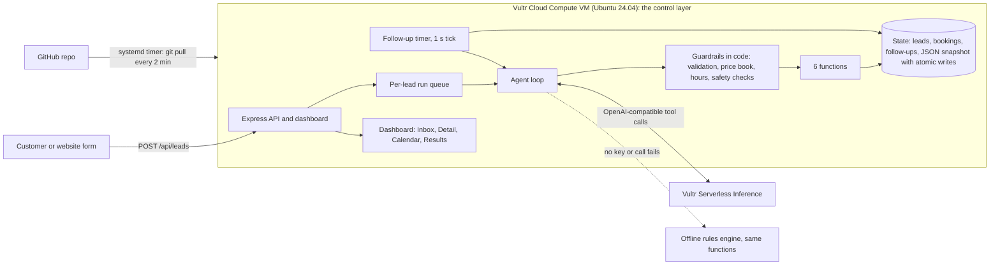

# First Answer Agent

**An AI agent that answers new customer leads for local home-service businesses (roofers, cleaners, plumbers) in seconds: it qualifies the job, checks real open appointment times, books the visit, follows up if the customer goes quiet, and hands off to a human when it is unsure.**

Built for **Vultr Agent Rush (lablab.ai), Challenge 2: Powering the Future of Work** (sales operations and customer support).

> Disclosure: this repository was built during Vultr Agent Rush (Nov 3-8, 2026). It is new, original work started for this event.

## Why it matters

For a local service business, the job usually goes to whoever answers first. A homeowner with a leaking roof messages three companies and books the first one that replies with a real time slot. Small shops miss that window because the owner is on a ladder, in a crawl space, or asleep. First Answer Agent closes the gap: every lead gets a useful, honest first reply in seconds, around the clock, and anything risky goes straight to a person.

## What you can see in the app

| Screen | What it shows |
| --- | --- |
| **Live Inbox** | Every lead with job, source, **measured** reply time and status chip (New, Replied, Booked, Needs a Human). Header badge shows the true agent mode and model. "Simulate a new lead" runs a fictional Nashville-area scenario end to end. |
| **Lead Detail** | The conversation, a box to role-play the customer, and **"What the agent did"**: a step-by-step timeline of every function call with arguments, result and elapsed time. |
| **Calendar** | A real week view of bookings and open visit windows from the app's own calendar store. |
| **Results** | Average reply time, leads answered, jobs booked, handed to a human, and an inline-SVG chart. All computed from stored leads. |
| **Guardrails** | The rules the software enforces, the service area and the price book. |
| **/lead** | A public customer form. The customer watches the agent reply on the page. |

Screenshots (1440 and 390 px wide) are in [`docs/screenshots`](docs/screenshots).

## Architecture



### Vultr services used

* **Vultr Cloud Compute VM (Ubuntu 24.04)** is the control layer. It runs the Express API, the dashboard, the calendar and booking store, the follow-up timers, the guardrails and the agent loop. It is provisioned by one startup script ([`deploy/cloud-init.sh`](deploy/cloud-init.sh)).
* **Vultr Serverless Inference** (OpenAI-compatible, `https://api.vultrinference.com/v1`) is the agent's reasoning engine. The agent sends chat-completion requests with function definitions and executes the function calls the model returns. Default model: `glm-5.3-flash` (override with `VULTR_INFERENCE_MODEL`).

Serverless Inference is optional for this challenge, but it is wired in as the primary path. The VM works on its own: with no key the same app runs in offline rules mode.

## The agent: how it executes real tasks

Every lead run is a tool-calling loop. The model never touches state directly; it can only call six functions, and every call is validated and guarded in code.

| Function | What it really does |
| --- | --- |
| `qualify_lead` | Records job type, urgency, size and location. **Code** decides service-area (city and ZIP list) and returns the only price range the agent may quote from the price book. |
| `check_calendar` | Returns real open windows from the calendar store (business hours only, 2 hours notice, no taken slots). |
| `book_job` | Writes a booking. Refuses double booking (synchronous check-and-write), slots outside business hours or in the past, out-of-area or out-of-scope leads, and leads already flagged for a human. |
| `send_reply` | Writes the outgoing message into the thread. **Simulated send**: no SMS or email leaves the app. Passes the outbound guard first. |
| `schedule_followup` | A real timer in the app. If the customer has not replied when it is due, the follow-up is posted; if they replied, booked or were handed to a human, it is cancelled. |
| `escalate_to_human` | Flags the lead **Needs a Human** with a reason and priority, and cancels timers. |

Reliability: per-lead serialized runs, a cap on concurrent runs, a step cap per lead (default 8), a per-call timeout (default 20 s), retries with exponential backoff on 429 and 5xx, an hourly cap on model runs to bound cost, and strict argument validation (types, enums, lengths, unknown keys dropped, control characters stripped).

### Offline rules mode

If `VULTR_INFERENCE_KEY` is not set, or an inference call fails, a deterministic rules engine follows the **same path** and calls the **same guarded functions**. The run is labeled "Offline rules mode" in the timeline and in the header badge. The badge never shows a model name unless a model is actually answering, and it switches to "Offline rules mode (model unreachable)" after a failed call. Reply time is measured from lead arrival to the first reply, so offline replies are honestly near-instant and model replies include inference latency.

### Guardrails (enforced in code, not only in the prompt)

* **Business hours:** no booking outside Mon-Fri 8-5 and Sat 9-1 Central. Slots only come from the calendar store.
* **Price book:** any dollar amount in a reply must fall inside the range from `qualify_lead`. Otherwise the message is blocked; the agent must quote the range, offer a free on-site estimate, or hand off. Discounts, refunds, guarantees, warranties, free work and links are blocked.
* **Always hand off to a human:** emergencies (active roof leak, flooding, gas, fire, structural; priority "urgent", 911 reminder, earliest window held), complaints and angry customers (including shouting and legal threats), insurance claims, contracts, schedule changes, requests for a person, out-of-scope trades, out-of-area requests, unclear leads after two questions.
* **Prompt-injection resistance:** customer text is always data. It is fenced in the prompt, scanned by a deterministic classifier before any model call, and any attempt to give the agent instructions flags the lead for a human. Even a fully manipulated model cannot book outside hours, quote off-book prices or skip a required handoff, because the checks run in code after the model. See `test/safety.test.js`, `test/agent-offline.test.js` and `test/model-loop.test.js`.
* **Public endpoints:** body size limit (8 KB), field limits, per-IP rate limits, strict CSP headers, all customer text HTML-escaped on render. The customer thread needs an unguessable per-lead token and exposes messages only.

## Run it locally

Requires Node 22. No build step.

```bash
npm install
npm start            # http://localhost:3000, offline rules mode, sample day pre-loaded
```

To use Vultr Serverless Inference:

```bash
export VULTR_INFERENCE_KEY=...            # never commit this
export VULTR_INFERENCE_MODEL=glm-5.3-flash   # optional, this is the default
npm start
```

Useful environment variables are listed in [`.env.example`](.env.example). `npm run seed` resets the data file and reloads the sample day (6-8 fictional leads across Replied, Booked and Needs a Human; real runs append to it and Results can filter to "Live agent runs only"). Follow-up delays run on a demo clock (`FOLLOWUP_SPEEDUP`, default 60, so 30 minutes fires in 30 seconds); set it to `1` for real time.

Public intake: open `/lead`, or `POST /api/leads` with JSON `{ "name", "phone", "message", "source" }`.

## Deploy on Vultr

1. Create a Startup Script from [`deploy/cloud-init.sh`](deploy/cloud-init.sh) (Products > Startup Scripts). Set `VULTR_INFERENCE_KEY` (and optionally `REPO_URL`, `VULTR_INFERENCE_MODEL`) at the top of the script. Secrets are written to `/etc/first-answer-agent.env` (mode 640) at install time and are never in the repo.
2. Deploy a Cloud Compute VM, Ubuntu 24.04, with that startup script.
3. The script installs Node 22, clones the repo, creates a `systemd` service listening on **port 80**, opens only ports 22 and 80 in `ufw`, and installs a `systemd` timer that runs `git pull` and restarts the service **every 2 minutes**. To redeploy, push to the repo.
4. Check `http://<vm-ip>/api/health` (mode, model, version, uptime).

## Tests

```bash
npm test      # node --test, 95 tests
```

Covers: function validation, price-book and outbound guards, booking conflicts and races, business hours, the safety classifier, prompt-injection attempts, the offline engine, follow-up timers, the tool-calling loop against mocked and real local OpenAI-compatible servers (tool calls, empty content, a `reasoning` field, malformed arguments, timeouts, 401, 500 with retry, step cap), API validation, rate limiting, persistence and the deploy script.

## Honest limitations

* **Messages are simulated.** No real SMS or email is sent, and there is no real phone number behind the form. Demo data is fictional.
* **The calendar is the app's own.** There is no Google Calendar or Outlook sync yet.
* **Auth:** the demo dashboard is open and role-play endpoints are rate limited. A real deployment needs sign-in and per-business tenancy.
* Storage is a single JSON file, which is fine for a demo and one VM, not for scale.
* The rules classifier is deliberately conservative: it may hand off an ordinary message that sounds like an instruction. That is the safe direction.
* Prices and service area are example configuration in [`src/config.js`](src/config.js).

## Real next steps

* GoHighLevel integration: create contacts and opportunities, send real SMS through its conversations API, sync appointments.
* Twilio or carrier SMS for true two-way texting, with consent and quiet hours.
* Google Calendar and Outlook two-way sync, with crew and travel-time rules.
* Per-business configuration screen for hours, price book and service area; multi-tenant accounts and sign-in.
* Call-answer and missed-call text-back, photo intake for roof and gutter jobs, review requests after the job.

## License

MIT. See [`LICENSE`](LICENSE).
